<!-- DOC_LOCAL_BEGIN -->
## 文档说明

| 项 | 内容 |
|---|---|
| 代码范围 | `/data/os-learn/docs/assets/linux-architecture/`、已有两个 HTML 页面；参考源码为本地 Linux 6.12.112；实验客体使用该版本真实 Linux |
| 关联需求 | 在 QEMU 中真实运行裁剪 Linux，从 CPU 复位、汇编引导到内核与用户程序逐步调试，同步查看 CPU、内存、总线、外设、文件、磁盘，并对照学习 |
| 目的 | 提供可交给后续模型逐项实施的设计、接口约束、任务边界与验收条件 |
| 读者 | 项目负责人、实现前后端和调试采集的模型、验收人员 |
| 呈现 | 设计基准、推荐路线、数据协议、真实实验、分阶段交付与证据要求 |
| 不呈现 | 将设计当成已实现结果；尚未运行的 QEMU/GDB 兼容性结论 |
| 调查日期与状态 | 2026-10-15 的设计基准；当次产物为方案与架构图。当前实现与实测状态见 `docs/os-debug-lab-acceptance.md` |
<!-- DOC_LOCAL_END -->

# Linux 真实调试学习平台实施方案

推荐建设一个由 **QEMU 驱动的可视化调试实验台**。第一套实验固定为 **SeaBIOS → GRUB → Linux 6.12.112 → BusyBox → shell → 读取文件**，前端以同一份停止快照更新全部视图；解说绑定真实地址、符号和事件。完整交付以第 12 节的真实实验验收为准。启动后的学习范围见第 3.4 节，前后回看语义见第 9.2 节。

## 1. 页面定位与设计范围

本节列出设计所涉及的页面和资源职责；实现进度与验收结果以验收报告为准。

| 对象 | 数据或内容职责 | 方案中的处理 |
|---|---|---|
| `docs/linux-kernel-architecture.html` | 内嵌源码和说明的静态阅读页 | 保留为 Linux 参考资料，从实验中的概念卡链接过去 |
| `machine.js` | 手工编写 `KMACHINE.init/ops`；寄存器和多数地址是示意值 | 用于概念演示；实验运行状态取自 QEMU/GDB |
| `anim-machine.js:prepare/apply` | 按课程步骤累计应用手工状态，预生成画面 | 提取布局、颜色、说明卡的表达方式；数据层重写 |
| `anim.js:render` | 由浏览器播放时间计算动画位置 | 实验界面消费后端 Frame；浏览器时间只控制过渡动画 |
| `story-boot.js` | 启动原理与步骤说明 | 实验课程按真实执行顺序编排；固件部分使用固件源码和符号 |
| Linux 注释 | 绑定本地 Linux 6.12.112 的函数与代码 | 核对注释与实际构建、设备配置和执行路径的对应关系 |
| 工作目录 | 代码位置见第 10 节 | 仓库和索引管理独立于文档任务 |
| 实验工具 | QEMU、GDB、GCC、Node 与镜像工具 | 安装和锁定属于任务 T01；验证结果以真实进程与采集证据为依据 |

## 2. 固定第一套实验环境

### 2.1 选择与范围

“小型 Linux”通过裁剪配置和用户空间实现，保留真实 Linux 内核机制。QEMU 提供可观测的虚拟硬件；客体运行本地源码编译出的 Linux。系统调用、页缓存、调度、文件系统和驱动均由 Linux 实际执行。总线采集范围为功能级事件：内存访问、端口/MMIO、DMA、设备请求和中断。

| 项目 | 第一套实验的决定 | 原因或边界 |
|---|---|---|
| 客体内核 | 当前本地 Linux 6.12.112，x86_64 | 保持与现有源码讲解一致；锁定源码散列、配置和构建产物 |
| 最小用户空间 | 静态链接 BusyBox，提供 sh、init、mount、cat 等 | BusyBox 提供用户程序，内核仍是 Linux；另外保留两个可带调试符号的极小实验程序 |
| CPU / 执行方式 | `qemu-system-x86_64`、1 个 vCPU、TCG 单线程 | 便于完整单步和插桩；执行环境固定为单核软件模拟 |
| 主板 | i440fx PC 的具体版本化 machine type；CPU 初选 `qemu64` | T01 验证支持所选 Linux 配置后锁定，避免随 QEMU 默认值变化 |
| 固件 | 可重建、有匹配源码/符号/ROM 的 SeaBIOS | 覆盖 CPU 复位到引导器；采集起点为虚拟 CPU 复位 |
| 引导器 | BIOS 版 GRUB，完整启动课使用 `linux16` / `initrd16` | 显式进入 Linux 16 位 setup，再经过 32/64 位入口；实际可用性由 T01 验证 |
| 启动盘 | IDE `boot.img`：MBR、GRUB、含 bzImage/initramfs 的分区 | 避免固件对 virtio 启动的依赖；它承载启动材料 |
| 根文件系统盘 | virtio-blk `rootfs.img`，第一版用 ext2 | Linux 启动后实际执行 VFS、ext2、页缓存、块层、virtio-blk 和 DMA；ext4 作为后续课程 |
| 文件布局 | 根盘直接为 ext2 文件系统，客体设备 `/dev/vda` | 独立于启动盘；/data 中放固定内容的大文件、hello.txt 和写入目标 |
| initramfs | 小型 cpio.gz，包含 BusyBox 与明确的 `/init` | 挂载 proc/sys/dev，挂载 `/dev/vda`，移动必要挂载点，`switch_root` 到根盘 `/sbin/init` |
| 外设 | VGA 文本、16550 串口、PS/2、PIC/I/O APIC/Local APIC、实际启用的计时器、virtio-blk | 开启设备按能力表展示，课程可观察真实输入、显示、DMA 和中断 |
| 内存 | 初选 512 MiB | 优先稳定启动和保留调试能力；最小内存以测量结果为准 |
| Web | React + TypeScript + Vite；SVG 拓扑、虚拟滚动表格 | 组件独立开发，所有值来自统一 Frame |
| 服务 | Node.js LTS + TypeScript + Fastify + WebSocket；GDB/MI 子进程 | 一个服务持有会话与调试连接，前后端共享协议 |
| 采集扩展 | QEMU C 观察扩展，按需要配合 TCG 插件 | 补齐设备无副作用快照、DMA 及停止屏障；见第 6 节 |
| 运行范围 | 本机/开发服务器，单用户优先 | 浏览器通过同源服务访问，QMP/GDB 使用服务端 Unix socket |

BusyBox 以一个可配置程序提供常用 Unix 工具，适合这里的最小用户空间。[BusyBox 说明](https://www.busybox.net/about.html)

GRUB 的普通 `linux` 命令使用 32 位引导协议，`linux16` 使用传统 16 位协议。完整启动课程必须验证所选命令实际经过的入口，动画只呈现已执行的入口。[GRUB linux](https://www.gnu.org/software/grub/manual/grub/html_node/linux.html)、[GRUB linux16](https://www.gnu.org/software/grub/manual/grub/html_node/linux16.html)

版本锁文件记录：内核源码散列、`.config`、QEMU tag/commit/补丁与构建参数、machine/CPU、SeaBIOS ROM/map/源码散列、GRUB 配置与符号、BusyBox/libc/工具链版本、两块磁盘及 initramfs 散列、所有 ELF build ID、课程与协议版本。T01 填入实际值，交付配置使用锁定版本。

### 2.2 内核裁剪与构建

从 `x86_64_defconfig` 开始做明确的配置片段，先验证启动，再按实验范围裁剪驱动。最终保存 `defconfig + fragment + olddefconfig 后的完整 .config`。

| 配置组 | 需要保留/启用的能力 | 实施注意事项 |
|---|---|---|
| 调试信息 | `CONFIG_DEBUG_INFO` 所选 DWARF 版本、`CONFIG_GDB_SCRIPTS`、`CONFIG_KALLSYMS`、完整类型信息、帧指针回溯 | 以该源码 Kconfig 实际选项为准；关闭 reduced debug info，执行 `make scripts_gdb` |
| 机器与启动 | 64 位 x86、PCI、ACPI、APIC、ELF、initramfs、gzip 解压 | 单 vCPU 可保留 SMP 内核配置以使用常规 x86 路径 |
| 文件与磁盘 | ext2、virtio、virtio PCI、virtio block、proc、sysfs、tmpfs、devtmpfs | 启动必需驱动编入内核，DAX 保持关闭 |
| 控制台/输入 | VT、VGA console、8250 console、TTY、i8042/AT keyboard | VGA 和串口是不同输出/输入通路 |
| 可选辅助追踪 | tracing/tracepoints，按实验开启指定 scheduler、block、syscall 事件 | 只作 Linux 语义补充；早期启动与硬件状态由独立采集通道提供 |
| 减少变量 | 关闭 KASLR、5 级页表；教学 profile 关闭 KPTI；用户地址随机化用明确启动策略关闭 | 记录为本实验教学配置 |
| 后续可选功能 | 网络服务、音频、GPU、容器、桌面用户空间 | 按后续课程需求增加 |

保持内核正常优化配置，满足 Linux 对工具链和优化的要求。被内联或优化掉的变量如实显示，重要机制用反汇编和真实字节解释。BusyBox 和专用用户实验程序可独立选择便于调试的构建参数。Linux 官方提供 GDB 脚本、调试信息和关闭 KASLR 的相关说明。[Linux 6.12 GDB 调试](https://docs.kernel.org/6.12/dev-tools/gdb-kernel-debugging.html)

构建目录与 `src/linux-6.12.112` 分离；保留至少 `vmlinux`、`System.map`、`bzImage`、setup 阶段的 ELF/符号、`arch/x86/boot/compressed/vmlinux`、DWARF、反汇编和源文件散列。`startup_64` 在解压器和主内核里分别存在，解析时必须带模块身份。

### 2.3 启动模板与两个 profile

下面是 **T01 设计模板**，变量由配置生成。所有写入只进入每会话独立的 qcow2 覆盖层；实际启动命令与结果以验收证据为准。

```bash
qemu-system-x86_64 \
  -machine "$LAB_MACHINE" -cpu "$LAB_CPU" \
  -accel tcg,thread=single -smp 1 -m 512M \
  -bios "$LAB_BIOS_ROM" -boot order=c \
  -drive file="$LAB_BOOT_OVERLAY",format=qcow2,if=ide,index=0 \
  -drive file="$LAB_ROOT_OVERLAY",format=qcow2,if=none,id=rootdisk \
  -device virtio-blk-pci,drive=rootdisk,id=rootblk \
  -display none -vga std -nic none \
  -serial unix:"$LAB_SERIAL_SOCK",server=on,wait=off \
  -qmp unix:"$LAB_QMP_SOCK",server=on,wait=off \
  -chardev socket,id=gdb0,path="$LAB_GDB_SOCK",server=on,wait=off \
  -gdb chardev:gdb0 -S -no-reboot
```

`full-boot` 使用上述磁盘启动；GRUB 的配置中设置 `linux16 /boot/bzImage ...` 与 `initrd16 /boot/initramfs.cpio.gz`，采用显式 `nokaslr norandmaps pti=off console=tty0 console=ttyS0,115200 rdinit=/init`。`/init` 必须实现挂载和切换根目录的脚本逻辑。根盘 BusyBox init 明确在 `tty1` 启动交互终端，串口保留启动日志和辅助控制台；键盘课程使用 PS/2 → Linux VT/TTY → tty1 的实际路径。两种终端按各自输入来源分别显示。

`kernel-fast` 可用 QEMU `-kernel/-initrd/-append` 快速验证内核和文件 I/O。它只用于开发和相应课程；从复位经 GRUB 启动的验收使用 `full-boot`。课程页面和录制包均绑定对应 profile。

virtio 的 modern/legacy、split/packed ring、队列数及中断方式必须记录**实际协商结果**。第一版目标为单请求队列、split ring，配置和驱动协商通过验证后锁定；解码器遇到其他格式明确拒绝或使用对应解析器。

## 3. 页面操作和实验课程

主产品是**实时调试网页**。使用者运行真实 Linux 和程序，在旁边的网页控制暂停、断点和单步，检查各组件并阅读说明。HTML 是持续工作的客户端，由实验服务托管；服务通过 WebSocket 推送状态，并在服务端连接 GDB 的 Unix socket。

运行模式分三种：

| 模式 | 客体状态 | 侧栏的更新方式 |
|---|---|---|
| 自由运行 | Linux 正常运行，终端可交互 | 实际终端和设备事件可持续推送；计数概览带时间戳。需要一致寄存器/对象时暂停采集；上次完整帧保留并标明过期 |
| 实时调试 | 在断点/单步后停住 | 同一停止快照更新全部面板；可选自动逐步演示。需要周期性全组件刷新时显式启用短暂停采集，显示采样频率及对执行节奏的影响 |
| 历史回看 | 进入回看时先暂停并保存当前最新位置 | 后退/前进只切换不可变历史帧，全部组件同步回放；返回最新位置后才恢复真实执行 |

静态课程说明与动态状态是两类数据。说明可以预先编写，数值和执行路径必须来自本次运行。每个组件按实际采集结果展示；值保持原样时也标注本帧已采集。

### 3.1 学习者看到的界面

以 1440×900 桌面视口为主要设计目标，三个可调整宽度的区域加底部时间线：

| 区域 | 内容和交互 |
|---|---|
| 顶栏 | 实验名称、镜像版本、实时/回看模式、运行/停止/采集中状态、当前 frameId、调试粒度 |
| 左侧约 28% | 汇编与 C 源码联动；正在执行的位置、下一条指令、断点、调用栈；源码映射缺失时显示反汇编 |
| 中部约 47% | CPU 和设备拓扑概览；内存、总线、外设、文件、磁盘的详情标签页；选中对象可固定详情 |
| 右侧约 25% | 本步目的、发生了什么、为什么、函数/指令语义、观察任务；事实旁可点开原始证据 |
| 底部 | 停止快照时间线、断点命中、输入、中断、磁盘请求、异常；选择历史帧进入回看 |
| 常驻概览 | CPU、内存、总线、外设、文件、磁盘均保留概要状态与同一 frameId；详细表格按需展开 |

控制按钮必须有明确含义：

| 操作 | 行为 |
|---|---|
| 单条指令 | 执行一次调试器指令步进；遇到异常、重复字符串指令等情况按实际停止语义报告 |
| 源码步入/步过 | GDB 按当前 ELF 的源码映射执行；显示期间跨过的指令/事件数量，无法映射时退回指令视图 |
| 运行到下一教学点 | 按课程声明解析临时断点和条件；碰到用户断点、异常或超时先停止，展示实际停止原因 |
| 继续/暂停 | 实际控制 QEMU；运行中显示最后已提交帧及其时间，停止后生成新帧 |
| 后退 | 显示上一个已记录帧及其说明；后台 VM 保持最新停止位置 |
| 前进 | 历史模式中显示下一记录帧；到达最新位置后，使用明确的“执行下一步”按钮驱动客体 |
| 返回最新位置 | 回到进入回看前保存的 VM 停止帧；随后可继续真实执行 |
| 输入按键/终端字符 | 明确选择 PS/2 键盘或串口；发送真实输入并记录各自来源 |

自动演示采用“服务执行 → 停止采集 → 展示讲解 → 再执行”。播放速度只决定停留时间和动画速度；寄存器与内存数值来自已提交帧。

### 3.2 启动到终端：B 组课程（L00–L07）

各停点由实际构建的符号、指令位置和状态解析；地址只有架构固定位置才直接写常量。

| 课程 | 停点/动作 | 必须能观察和对照的内容 |
|---|---|---|
| L00 复位 | 冷启动，首条客体指令执行前 | CS 可见值/隐藏基址、IP、实际物理取指地址、ROM 字节和第一条反汇编 |
| L01 固件与引导器 | SeaBIOS → 磁盘 MBR → GRUB | 固件源码、磁盘扇区装到 `0x7c00`、GRUB 代码和装载位置；长区间可跳过但记录边界 |
| L02 Linux 16 位 setup | GRUB 按验证后的 `linux16` 协议交接 | `arch/x86/boot/header.S`、setup 代码、boot_params、内存图、段与栈；每个对象的地址从本次启动读取 |
| L03 32 位解压入口 | 模式切换、`compressed/head_64.S:startup_32` | GDT、CR0、进入保护模式的跳转、页表准备；16/32 位反汇编随真实状态变化 |
| L04 长模式与解压 | 解压器 `startup_64`，实际解压函数，跳到主内核 | CR4/EFER/CR0、页表、压缩输入/解压输出范围；解压器与主内核分开加载符号 |
| L05 主内核入口 | `kernel/head_64.S:startup_64` → `x86_64_start_kernel` → `start_kernel` | 内核高地址映射、栈、初始化调用；源码来自本地匹配 ELF |
| L06 初始化与 PID 1 | `rest_init`、`kernel_init`、执行 initramfs `/init` | 任务结构、用户地址空间、内核/用户栈、exec、根挂载前后的对象 |
| L07 真正磁盘根目录 | `/init` 挂载 virtio ext2、switch_root、BusyBox init/sh | virtio 设备与队列协商、ext2 superblock、根目录、shell 提示符 |

入口符号见上表；具体构建的执行路径、装载位置与断点地址以运行证据为准。引导参数解释遵循 [Linux 6.12 x86 boot protocol](https://docs.kernel.org/6.12/arch/x86/boot.html)。

### 3.3 先做一条确定可观测的 read 实验

先提供 `lab-read /data/probe.bin`：正常 Linux 用户程序，顺序执行 `openat → read → 校验 → write → close`，含可设置断点的命名函数和调试信息；内核行为由 Linux 执行。通过后再跑 BusyBox `cat`，如实跟随其可能使用的不同系统调用。

普通 ext2 buffered read 的源码观察候选：`fs/read_write.c` 的 `ksys_read/vfs_read`，`fs/ext2/file.c:ext2_file_read_iter`，`mm/filemap.c:generic_file_read_iter/filemap_read`；virtio 驱动的候选提交/完成点位于 `drivers/block/virtio_blk.c`。实际调用栈、请求异步提交、缓存命中、预读、合并和拆分均以真实事件为准。

`probe.bin` 在构建时写入确定内容，先冷启动读取，再连续读取一次对照缓存。若需强制建立冷缓存条件，须显式执行并记录客体 `sync`、`drop_caches` 等准备动作。文件偏移与 folio、bio/request、virtqueue descriptor、LBA 按实际多对多关系显示。

### 3.4 终端运行之后的完整课程

下表是第一套 Linux 实验的课程范围，各组验收要求真实用户操作、代码停点和跨组件证据。命令以最终 BusyBox applet 配置和实验程序实现为准。

| 课程 | 学习者实际操作 | 关键观察点与对应视图 |
|---|---|---|
| U01 等待输入 | 停在 tty1 的 shell 等待命令时 | shell 所处的实际系统调用、睡眠状态、等待队列、当前运行/空闲任务、输入缓冲；等待位置以实际 PC 和调用栈为准 |
| U02 按键和一行命令 | 点击真实终端，输入字符、退格、回车 | PS/2 make/break 码、i8042、IRQ、Linux input/VT/TTY、缓冲、唤醒、回显；显示实际 termios。BusyBox 编辑器可能启用非规范模式，另用 `lab-tty` 演示规范模式下 Enter 提交一行 |
| U03 用户程序和系统调用 | 运行 `lab-read`，再运行 BusyBox `cat` | 用户 C/汇编、syscall 指令、入口 `pt_regs`、用户/内核栈切换、返回值、输出；可停在函数内部任意指令 |
| P01 创建与执行 | `lab-fork-exec` 调用 fork/exec/wait | task_struct、PID、父子关系、clone 系统调用路径、exec 更换 mm 和 ELF、父进程等待及唤醒；按实际 libc 包装调用解释 |
| P02 调度 | 两个 CPU 工作进程与一个等待进程 | runnable/sleeping 状态、CPU 当前任务、运行队列、`__schedule/context_switch`、保存的上下文；按 Linux 6.12 实际调度策略解释 |
| P03 管道 | `cat /data/hello.txt \| wc -c` | pipe 缓冲、文件描述符、生产/消费、阻塞与唤醒；共享 pipe inode 绑定内存中的管道对象 |
| P04 信号和退出 | 发送 SIGTERM、wait 回收；用受控程序展示 zombie | 信号 pending/delivery、处理程序或默认动作、exit、退出码、父进程回收、资源释放 |
| M01 虚拟地址和物理页 | `lab-memory` 创建匿名 mmap，按页第一次写入 | VMA、页表初始缺项、缺页入口、实际分配页、PTE 和字节；区分申请地址空间与实际分配物理页 |
| M02 写时复制 | `lab-cow` 先触页，再 fork，子进程写一页 | 父子 mm、两个页表指向关系、权限、写保护 fault、分配/复制后的 PFN 和不同内容；实验明确关闭 THP，避免页粒度歧义 |
| M03 堆与释放 | `lab-alloc` 进行 malloc/free 和 brk/mmap | 用户分配器元数据、实际系统调用和 VMA；物理内存归还时机与 brk 调用次数以分配器行为和采集证据为准 |
| M04 文件映射 | `lab-mmap-file` 做 MAP_PRIVATE 与 MAP_SHARED 对照 | 文件页缓存、映射页、私有写时复制、共享脏页、msync/回写和磁盘差异 |
| M05 访问异常与回收 | `lab-fault` 访问禁止页；另做受控内存压力 | fault 地址/错误码、VMA 权限、SIGSEGV；回收课显示 LRU/回收计数和实际候选页，swap 按实验配置决定展示范围 |
| F01 目录与打开文件 | mkdir、ls、openat、close | VFS mount/dentry/inode、路径查找、fd table、file offset 和引用关系；硬盘上尚未写回的元数据单独标记 |
| F02 冷读/热读 | 第 3.3 节读取实验 | 缓存 miss/hit、folio、bio/request、virtio 队列、DMA、LBA 与文件偏移关系 |
| F03 写入和同步 | `lab-write` 写固定字节并 fsync | 用户缓冲、脏页、writeback、请求完成、fsync 返回与读回；本课展示 ext2 的直接写回路径 |
| F04 共享偏移和删除 | dup/独立 open 对照；open 后 unlink 再继续读 | fd→file→inode 关系、共享/独立 offset、目录项删除与已打开文件生命周期 |
| H01 时钟和外设 | 等待时钟中断、完成磁盘请求、输入字符 | 实际 IRQ/vector/路由、APIC 状态、DMA 和中断前后栈；区分不同设备的真实路径 |

这些课程中的对象页都提供“原始字节/结构字段 → 源码定义 → 原理说明”三层。先支持当前任务、选定地址、选定文件及其关联对象，限制链表/树的遍历数量；停止时发现中间态或结构尚未初始化则显示解析状态和已有字段。

### 3.5 运行自己的程序与连接已有实验

平台允许把新的用户程序源码和带符号 ELF 加入根盘，启动后在真实终端执行，并在网页加载该 ELF 的源码映射。课程支持用户自行设断点、单步、检查组件，旁栏展示已有的指令/函数说明和实时事实。源码或讲解缺失的程序使用反汇编和通用组件视图；逐行语义解释须补充匹配的讲解资料。

第一版由平台启动 QEMU，保证控制接口、符号、观察扩展和镜像一致。后续可连接已经由兼容 profile 启动、开放 GDB/QMP 且由平台独占调试控制权的 QEMU 会话。整机设备和物理内存视图依赖虚拟机的观察能力，前端只展示后端提供的字段及能力缺口。

## 4. 系统结构和职责



| 模块 | 输入 | 输出 | 职责边界 |
|---|---|---|---|
| SessionManager | 实验 profile、镜像和版本清单 | 独立 QEMU/GDB 进程、socket、日志和会话 ID | 只管理运行资源，状态数值由采集层提供 |
| DebugController | 带 requestId 的控制命令 | 标准化 StopReason、断点和执行结果 | 统一管理 QMP 与 GDB 控制操作 |
| Observer | CPU/设备状态、访存、I/O、异步完成事件 | 原始快照与有序证据、能力声明 | 只报告实际采集的事件和缺口 |
| SnapshotCoordinator | 停止通知和各采集结果 | 原子提交的 Frame，或明确的采集错误 | 所有面板数据绑定同一停止快照 |
| SymbolResolver | ELF/DWARF、ROM map、当前模式和地址 | 指令、源码位置、类型布局、装载模块 | 用户地址绑定所属用户 ELF 和执行世代 |
| LinuxDecoder | 同帧内存字节、符号、类型布局 | 进程、页表、文件、缓冲区等结构化对象 | 只通过读取快照解析对象 |
| LessonEngine | 当前帧、课程条件、解释模板 | 命中的教学点、说明及证据链接 | 只解释已提交帧；完成条件由真实字段判定 |
| TraceStore | Frame、事件、镜像/源码清单 | 可回看的录制包和索引 | 只重建画面数据，VM 保持最新停止位置 |
| WebStore | 完整帧、历史帧、局部详情响应 | 所有组件共享的当前帧 | 组件只从统一 store 派生视图 |

QMP（QEMU Machine Protocol）负责机器管理和事件通信，GDB/MI（机器接口）负责调试交互；两条通道均由实验服务管理。[QMP 协议](https://www.qemu.org/docs/master/interop/qmp-spec.html)、[GDB/MI](https://sourceware.org/gdb/current/onlinedocs/gdb.html/GDB_002fMI.html)

## 5. 视图的数据来源与真实性

### 5.1 统一证据类型

每个显示字段携带 `provenance`，详情可展开来源。数据缺失使用 `null + reason`，实测零值使用数值 0。

| 标记 | 含义 | 例子 |
|---|---|---|
| observed | 直接从客体运行状态或实际执行事件采集 | RAX、物理内存字节、实际设备端口读写 |
| decoded | 由同一帧的原始证据按确定规则解析 | 页表映射、`task_struct`、inode、标志位解释 |
| explanation | 静态原理或对已观测事实的解释 | 为什么要加载 GDT、函数的职责 |
| unavailable | 当前能力、版本或运行阶段存在采集缺口 | 采集范围外的设备内部字段、历史帧存档范围外的地址 |

所有“变化高亮”来自帧间 diff；总线连线上的活动来自实际事件。文件系统初始化之前显示对应阶段状态，目录树只来自已采集并成功解析的对象。

### 5.2 各组件具体实现

| 组件 | 必须展示 | 获取和解析方式 | 交互及精度边界 |
|---|---|---|---|
| CPU | RIP/RSP、通用寄存器、RFLAGS、CR0/2/3/4、EFER、段缓存、GDTR/IDTR、特权级、停止原因 | GDB 与观察扩展形成统一快照 | 位字段可展开，点击指令/栈地址联动；展示范围为架构状态与实际执行事件 |
| 物理内存 | RAM/ROM/设备区域、Hex/ASCII、字节变化、访问列表 | 安全 RAM/ROM 接口，4 KiB 页获取、字节 diff | 默认 PC/SP/对象附近；采集范围外的页标注缺口 |
| 虚拟内存与页表 | 段内/线性/物理地址、页表各级、页大小、权限 | 当前模式与 CR3、页表字节；覆盖启动期 32 位表及目标 64 位四级表、实际大页 | 标为按当前页表解析的映射结果 |
| 栈与变量 | 栈字节、调用帧、参数、局部变量、pt_regs | GDB/DWARF 与当前栈；启动/异常入口专用解码 | 变量优化和回溯缺口显示原因，只展示已取得的值 |
| 总线/访问 | CPU 访存、PIO/MMIO、DMA、中断、块请求的地址/值/宽度/顺序 | 指令/访存探针、设备和 DMA 观察点 | 功能级事件图，动画速度用于讲解；区分 CPU 与设备发起访问 |
| 输入外设 | 串口字节/PS2 扫描码、队列、状态、IRQ、驱动读取 | 真实输入、设备字段与 I/O 事件 | 从设备快照读取队列与状态；区分送入设备与被 Linux 读取 |
| 中断/计时器 | pending/mask/in-service、向量、路由、配置、送达 | 实际启用模型的快照与事件 | 区分 IRQ 拉起、控制器处理、CPU 接受；向量来自实际路由 |
| 显示器 | VGA 字符/属性、光标、串口实际输出 | backing store 与控制状态、串口字节 | 第一版固定文本模式；VGA 与串口各自绑定真实数据源 |
| virtio-blk | PCI 配置、协商 feature、queue 地址、desc/avail/used、请求/完成、IRQ | 设备快照、DMA 事件、同帧队列内存，按实际 ring 格式解析 | descriptor 地址和长度可定位物理内存；保留 guest request 与设备 request 关联证据 |
| 磁盘 | 启动盘/根盘、LBA、扇区内容、请求长度和状态 | 基线镜像 + 第 6.3 节逻辑扇区版本 + 设备快照 | 根盘必须有真实块 I/O；磁盘活动只绑定实际块请求 |
| 文件 | 目录、inode、大小、文件块、fd、offset、页缓存/脏页/回写 | ext2 磁盘结构 + 同帧 task/files/file/dentry/inode/address_space/folio | 磁盘和缓存分层显示，点击文件定位对应块/扇区；只遍历选定文件和有限对象 |
| 进程 | pid、comm、状态、当前 CPU 任务、mm、栈、fd | Linux DWARF 与内存解析，必要时参考匹配的内核 GDB helpers | task 是内存对象；用户 ELF 按 mm/exec 世代绑定 |

区域分类后的读取规则见第 6.2 节；设备快照应保持客体输入队列与中断状态原样。

## 6. 真实状态的采集实现

### 6.1 先打通标准接口，再补齐观察扩展

| 能力 | 标准接口起点 | 完整交付所需工作 |
|---|---|---|
| 单步/断点/寄存器 | GDB/MI，`-exec-step-instruction`、`-break-insert`、寄存器读取 | 解析 MI token、异步记录、错误和停止原因；按目标描述发现寄存器编号与布局 |
| 普通内存 | GDB 内存读取；QEMU gdbstub 支持物理内存模式 | 地址空间切换必须在服务锁内执行并恢复；最终优先用独立物理 RAM/ROM 读取接口 |
| CPU 扩展状态 | 能力探测时可对照 HMP `info registers` | 正式 JSON 接口提供段缓存与模式字段，避免长期依赖易变的文本解析 |
| 指令/CPU 访存 | TCG 插件的指令执行和访存回调 | 验证锁定版本的值、物理地址和操作宽度能力；端口 I/O、设备 DMA 分别核对采集覆盖 |
| 设备与块事件 | QEMU 自带 trace-events | 枚举实际事件后评估覆盖；补上缺失字段、请求 ID、阶段和事件顺序 |
| 设备当前状态 | QMP 管理查询提供设备管理信息 | 对课程涉及设备增加只读快照；扇区内容通过逻辑磁盘版本读取 |
| 停止边界和事件齐备 | GDB 停止通知、QMP 运行状态 | 用下节观察屏障和 eventWatermark 确认事件已封存 |

QEMU 文档描述了 gdbstub 的步进选项和物理内存模式；TCG 插件 API 与 trace-events 是另外的观测机制，需分别验证能力。[GDB 支持](https://www.qemu.org/docs/master/system/gdb.html)、[TCG 插件](https://www.qemu.org/docs/master/devel/tcg-plugins.html)、[QEMU tracing](https://www.qemu.org/docs/master/devel/tracing.html)

### 6.2 观察扩展的最小合同

下列 `x-oslab-*` 是**本项目的 QEMU 观察扩展合同**。扩展单独保存在 `instrumentation/qemu-observer/`，按锁定 QEMU 版本维护补丁和编译测试；实现状态见验收报告 T05。

| 扩展接口 | 返回内容/约束 |
|---|---|
| `x-oslab-capabilities` | 协议版本、可观测 CPU/设备字段、访存/块事件类型、是否支持停止屏障、当前丢失事件计数 |
| `x-oslab-capture` | 确认全部 vCPU 停止，在设备所属线程/锁的正确上下文中冻结一份快照，返回 captureId、CPU/设备字段、eventWatermark、可读内存区域、磁盘逻辑版本 |
| `x-oslab-read-physical` | 仅在 captureId 有效且 VM 保持对应停止状态时读取允许的 RAM/ROM；超范围/MMIO 拒绝；返回字节和所属快照 |
| `x-oslab-events` | 按序号分块读取事件，直到 capture 的 watermark；显式报告丢失、过滤和截断 |
| `x-oslab-release` | 完成采集、释放冻结资源；之后才能继续执行 |

推荐把课程涉及的设备留在默认主循环，禁用额外设备 I/O 线程，降低第一版并发复杂度。即便 vCPU 已停止，宿主块 I/O 仍可能在完成：`capture` 必须区分“后台工作已完成”和“完成回调已对设备可见”，以统一串行化点截取设备状态与事件；未对客体可见的请求仍为 pending。

采集期间须保持待完成请求、虚拟时钟和中断的客体状态；禁止主动 drain 请求或推进客体状态来完成采集。锁和执行上下文必须按锁定版本逐项审查。T05 以“停止时有未完成 I/O”的实验检验屏障。

事件至少包括：`instruction.begin`、`memory.read/write`、`dma.read/write`、`io.read/write`、`irq.raise/lower`、`interrupt.accept`、`block.submit/complete`、`input.accept`、`serial.output`、`capture.fence`。事件有全局递增 `seq`，同时保留 vCPU、设备、requestId 和可选 instructionId。异步事件的 PC 只填可靠来源，来源缺失时留空并标注原因。

TCG 指令执行前回调代表“即将尝试执行”，指令完成情况由后续事件与停止原因判定。异常、`rep` 字符串指令、一个操作拆成多次访存等情况保留原始事件粒度。取指展示可用实际 PC 与指令字节重建，并标明其证据类型为解析结果。

第一版具体观察点搜索范围：QEMU 的 x86 CPU/gdbstub、TCG memory callbacks、`memory_region_ops_*` 对应访问路径、启动 IDE、virtio-blk/virtio PCI、DMA address-space 访问及块完成回调、i8042、串口、PIC/APIC、VGA。先验证已有钩子，再补齐采集缺口；探针按实际设备与执行事件定义。

### 6.3 磁盘状态与全量内存覆盖

磁盘采用“基线镜像 + 逻辑扇区版本”表达：观察块写入的扇区、数据、完成结果，在设备可见的成功完成点提交新版本。未完成请求保留单独的待写数据；部分成功按实际已完成范围记录。此版本用于同帧文件/磁盘视图，持久化验证采用下面的独立验收。创建或重新打开录制会话时，基线和版本链必须一起绑定。

独立验收时先让客体完成指定写入和 fsync，再停止并关闭 QEMU，离线读取最终写入层，与逻辑扇区版本逐块比较。镜像工具只读取已关闭的写入层，保留镜像锁约束。

内存实现分两级，界面注明覆盖范围：

- 实时调试：采集可见页、页表、当前栈和课程对象；任意地址仅能在当前 VM 仍停止且 capture 有效时按需读取。历史帧缺页时显示未记录。
- 完整课程录制：在起点保存全部 RAM；每个提交帧保存实际脏页和必要设备 backing store 的增量。脏页必须覆盖 CPU、设备及其他写入路径；T06 用全量 RAM 散列对照验证。全量校验通过后才可声明支持历史任意 RAM 地址；校验待完成时交付范围为“局部内存录制”。

快速运行区间允许只保存两端快照及筛选事件，标记为“区间记录”，同时标注中间指令的采集缺口。需要精细学习的窗口采用逐步完整采集。

## 7. 同一停止时刻的同步协议

### 7.1 帧的语义

`Frame(n)` 表示一次已完成采集的停止状态；它关联的事件区间为上一帧之后到本帧屏障之前。时间线同时显示“执行前 PC”“本次停止 PC”和“停止原因”，避免将停止 PC 当成刚执行过的指令。

```typescript
type Hex = `0x${string}`;
type EvidenceKind = 'observed' | 'decoded' | 'explanation' | 'unavailable';
interface EvidenceRef {
  kind: EvidenceKind;
  source: string;                  // gdb / observer / memory / disk / lesson
  captureId?: string;
  refs: string[];                  // 原始事件或字节范围的 ID
  reason?: string;
}
interface Frame {
  schemaVersion: 1;
  sessionId: string;
  epoch: number;                   // 重启后递增，响应须匹配当前会话世代
  frameId: number;
  parentFrameId: number | null;
  requestId: string;
  captureId: string;
  executionMode: 'live' | 'recorded';
  stop: { reason: string; pc: Hex | null; cpuId: number };
  eventRange: { first: string | null; last: string | null };
  coverage: {
    memory: 'selected-pages' | 'full-ram-delta';
    events: 'complete' | 'filtered' | 'lost';
    unavailable: string[];
  };
  cpu: CpuSnapshot;
  memory: MemoryPageRef[];
  devices: DeviceSnapshot[];
  diskVersions: Record<string, string>;
  os: OsSnapshot | null;
  source: SourceLocation | null;
  lesson: LessonMatch | null;
  evidence: Record<string, EvidenceRef>;
}
interface MachineEvent {
  seq: string;                    // 十进制字符串，避免 JS 数值精度损失
  kind: string;
  cpuId?: number;
  instructionId?: string;
  deviceId?: string;
  requestId?: string;
  pc?: Hex;
  addressSpace?: 'physical' | 'linear' | 'io-port' | 'disk-lba';
  address?: Hex;
  size?: number;
  bytes?: string;                  // 按规定编码保存原始字节，整数解释由解码层负责
  phase: 'begin' | 'complete' | 'raise' | 'lower' | 'fence';
}
```

这是协议骨架；T02 必须在 `packages/contracts` 补全其中引用的类型、字段限制及运行时校验。地址、寄存器、大计数统一字符串表示；二进制数据分块传输，内存小端解释由解码层完成。

### 7.2 一次操作的提交规则

1. 服务校验会话、epoch、期望 frameId、控制权与命令参数，将命令放入单会话串行队列。
2. 释放上一 capture，执行一次 GDB 控制操作；QMP 只承担由同一控制器发起的管理操作。普通 `continue` 只走 GDB 控制通道。
3. 等待匹配的 GDB 停止通知，核对 QEMU 运行状态；重复通知去重，超时先请求停止再报错。
4. 调用观察屏障获得 captureId/watermark；读 CPU、所需内存、设备与逻辑磁盘版本，取齐截至 watermark 的事件。
5. 所有解码器只读取本次 capture；得到 OS 对象、源码位置和事实引用。
6. 完成字段校验和覆盖检查，持久化原始证据及 Frame 后原子发送 `frame.committed`。
7. 前端一次替换 `activeFrame`，各组件由 selector 派生显示；数据齐备后播放事件过渡动画。

采集出错保持最后一个完整帧，显示错误和过期状态。观察到事件丢失时可以展示带 `lost` 标志的诊断帧，其真实性验收结果为失败。运行中追加的终端输出作为带时间戳的实时流单独标记，提交后才归入快照。

首次可整帧传 JSON；数据增大后用“帧清单 + 按散列引用的二进制页块”。视图统一按已提交帧更新。

### 7.3 API 合同

| 接口/消息 | 最小内容与行为 |
|---|---|
| `POST /api/sessions` | 输入 profileId、artifactManifestHash；返回 sessionId、capabilities、状态和首帧 |
| `POST /api/sessions/:id/commands` | requestId、epoch、expectedFrameId、命令类型和参数；幂等，同 requestId 只执行一次 |
| `GET /api/sessions/:id/frames/:frameId` | 返回该 epoch 的只读历史帧；epoch 通过查询参数明确指定 |
| `GET /api/sessions/:id/memory` | epoch/frameId/addressSpace/address/length；历史只能读存档，当前帧可从有效 capture 补充 |
| `GET /api/sessions/:id/events` | epoch、seq 范围、分页；拒绝混用不同会话范围 |
| `GET /api/sessions/:id/disk` | diskId、version、LBA、count；读取帧绑定的逻辑版本 |
| `GET /api/artifacts/:hash/source` | 按产物清单内允许路径读取匹配源码；响应包含文件散列和行号 |
| `WS /api/sessions/:id/stream` | `command.accepted`、`session.state`、`frame.committed`、`capture.failed`、`terminal.output`；重连携带最后确认帧 |
| `DELETE /api/sessions/:id` | 停止子进程、关闭 socket；按配置保留录制包并清理临时资源 |

多个浏览器观察同一会话时只允许一个控制者。命令参数限定为白名单操作；源文件和镜像路径限定在该会话的产物清单中。

## 8. 调试中的关键技术细节

| 问题 | 必须采取的实现办法 | 独立检查方法 |
|---|---|---|
| 复位取指地址 | 用真实 CS 隐藏基址加 IP 计算复位取指地址 | 对比 ROM 对应字节、QEMU CPU 状态与首条反汇编 |
| 16/32/64 位切换 | 解码器使用当前模式、CR0/CR4/EFER、段属性与实际指令字节；源码模块单独选择 | 在 `lgdt`、写 CR0、EFER、远跳转前后逐次比对 |
| 地址含义不同 | 数据类型显式区分段内偏移、线性地址、物理地址、端口和 LBA | 覆盖恒等映射、内核高地址映射和用户映射 |
| 断点改变代码 | 引导/ROM 优先请求硬件执行断点，验证目标支持；记录软件断点的字节替换策略 | 比较当前字节与原始 ELF/ROM，将调试器插入的字节标为断点修改 |
| 固件源码映射 | 构建匹配 SeaBIOS ROM、map/ELF，处理 16/32 位段布局与重定位 | 每个固件教学点校验 ROM 字节和实际符号映射 |
| 分页开启前的内核符号 | 区分 ELF 链接 VA、装载 PA 和执行阶段，使用明确装载映射 | 开启分页前后均能命中正确入口，显示同一函数对应的物理字节 |
| 内核/用户符号切换 | 用户模块按 pid + exec 世代 + ELF hash 管理；GDB symbol context 改动由控制器串行化 | 两个进程同 VA 各自显示匹配源码；exec 后只保留当前世代模块 |
| 结构布局 | 从匹配 ELF 的 DWARF 生成 offset/size 清单 | 在真实停点与 GDB `sizeof`/字段值对照；前端使用匹配构建的布局数据 |
| 中断与单步 | 提供“指令观察”和“事件推进”两种模式，明确 IRQ/计时器策略 | 指令观察验证精确变化；时钟/磁盘中断课使用允许事件推进的模式和临时断点 |
| 等待 I/O/HLT | 运行到受限停点并设置宿主超时；超时中止采集并显示当前原因 | 对照 IF、等待队列与磁盘请求，确认状态变化由实际执行产生 |
| 文件缓存 | 同时呈现 inode/cache/磁盘三层；缺少块请求时如实显示缓存命中 | 冷启动读取新的实验文件；对照第二次读取的不同事件 |
| 重启 | 新 epoch、新事件边界、重新建立符号和缓存；前一世代请求全部失效 | 注入前一世代帧响应，确认其被拒绝且界面保持当前 epoch |

QEMU 默认单步会抑制 IRQ 和计时器服务，支持查询/设置步进掩码。实现必须查询所用版本的能力并把实际策略显示在界面，中断课程据此选择事件推进模式。[QEMU 单步行为](https://www.qemu.org/docs/master/system/gdb.html#changing-single-stepping-behaviour)

## 9. 讲解、录制和性能

### 9.1 讲解数据

课程以 JSON/YAML 存储，经过 schema 校验，至少包含以下字段：

| 字段 | 用途 |
|---|---|
| `id`、`profileId`、`artifactConstraints` | 限定课程、架构和适配产物 |
| `trigger` | 模块 + 符号/指令偏移 + 前置状态；解析失败时禁用该课并说明原因 |
| `execution` | 运行到的边界、允许的中断策略、预算/超时 |
| `observe` | 要读取的寄存器、内存对象、设备字段及覆盖要求 |
| `focus` | 要联动选中的 CPU 字段、地址、源码和设备 |
| `explain` | 目的、函数输入输出、每条关键指令含义、相关原理；模板只能引用 Frame 中已有字段 |
| `checks` | 客体实际状态的后置条件，判定达到教学点；失败时展示差异 |
| `questions` | 学习者可先预测的结果，以及展开后对照的证据 |

示例：写 CR3 的教学点展示本次实际写入值，定位该物理地址处的页目录，解析当前 PC 对应页表项，并解释后续开启分页的作用。解释中的值全部从帧获取；遇到异常时展示实际异常及证据。

LLM 可离线帮助编写讲解，运行中的客体状态由确定性采集和解析生成。每段源码注释绑定文件 hash、符号和行区间；源文件更新后必须重新校验映射。

### 9.2 后退/前进采用历史状态回放

前后回看用于观察已执行过程。第一版直接保存调试帧，实时和历史模式共用渲染器，后台 VM 保持最新停止位置。

录制包包含 `manifest.json`、帧索引、事件分块、RAM 起点/增量、磁盘逻辑版本、输入与终端输出、源码/符号清单及课程版本。每个文件有校验散列。快照中的客体数据、显示屏内容、文件缓存和设备状态都随历史帧切换，历史查询只读取该帧存档。

| 情况 | 后退/前进的含义 |
|---|---|
| 连续做了 20 次指令单步 | 保存 20 次操作的停止帧；可逐帧退回和重新播放，异常与 rep 指令仍按实际停止语义说明 |
| 做了源码步过 | 回看一次源码步过前后的帧及期间采集的事件，中间 CPU 状态按记录覆盖范围展示 |
| 连续运行一段时间 | 回看采样点、断点、教学点及保留的事件；时间线标明中间状态的覆盖缺口 |
| 想查历史帧任意内存地址 | 完整 RAM 起点和覆盖全部写入的增量提供支持；局部录制范围外显示“本次未记录” |
| 回看到一半点击继续执行 | 控件指向“返回最新位置”，先显示实际 VM 停止帧；用户再执行下一步。历史模式的播放按钮只播放记录 |
| 输入键盘 | 历史模式禁用客体输入；返回最新位置后恢复 |

存储使用每 N 帧完整数据检查点加增量（初值 N=100，按大小调整）。检查点仅用于重建画面数据。先按页保存前后版本并用散列去重；随机定位先读最近数据检查点再应用增量。超过空间配额时明确停止记录，已有可点击帧保持可读。

### 9.3 性能目标与取舍

下列为设计阶段的验收目标，完整基准实测待完成；测量必须记载宿主 CPU、内存、构建版本和采集覆盖范围。

| 场景 | 初始目标 | 实现策略 |
|---|---|---|
| 指令单步，选中页 ≤ 64 KiB | 本机端到端 P95 ≤ 500 ms | 批量寄存器/内存读取，页缓存，合并 WebSocket 消息 |
| 内存滚动 | 已缓存页交互 ≤ 100 ms；缺页显示加载状态 | 4 KiB 页读取、虚拟列表、内容散列引用 |
| 自动讲解 | 默认每秒 1–3 个停止帧 | 帧提交后再开始过渡动画；慢速采集自然减速 |
| 正常启动快速运行 | 浏览器按教学点和事件摘要更新 | 后端事件分块、过滤及覆盖说明，按教学点停止 |
| 完整课程存档 | 先设每会话 2 GiB 硬上限并显示预计占用 | RAM/磁盘增量与压缩；达到上限时受控停止或明确降级并报告覆盖变化 |
| 长时间连续运行 | 有界缓冲区和事件丢失计数 | 高频数据写文件，浏览器订阅摘要；完整实验窗口要求事件丢失计数为 0 |

## 10. 设计目录与参考页面接入

以下为设计目录清单；实际文件与完成情况见任务卡和验收报告。

```text
apps/debugger-web/                 # React 界面、组件、Frame store
services/lab-server/               # 会话、GDB/MI、QMP、采集协调、HTTP/WS
packages/contracts/               # schema、类型、校验器
packages/linux-decoder/            # 进程、页表、文件和磁盘结构解析
packages/trace-format/             # 录制包格式、散列、索引、回看
instrumentation/qemu-observer/     # QEMU 补丁、插件、能力探测与对照测试
labs/linux-x86_64/                 # 构建脚本、配置、版本锁文件
labs/profiles/linux-x86_64.json     # 机器/设备/调试策略配置
curriculum/linux-x86_64/            # 课程条件、说明、观察任务
scripts/                          # doctor、build-lab、smoke、record、verify
artifacts/                        # 生成的 ROM、ELF、镜像和布局清单
var/sessions/                     # 每会话进程文件、覆盖层和录制；临时运行数据
docs/os-debug-lab-plan.md          # 本方案
docs/os-debug-lab-tasks.md         # 可直接分配给实现模型的任务卡
```

实验页面使用独立入口 `/lab`。参考动画页的实验链接以入口实际可用为接入条件；Linux 阅读页继续提供源码参考。实验页面的寄存器、页表、设备与中断路径依据实际阶段和 profile 展示。

## 11. 实施顺序与工作量

详细任务输入、产物和操作约束见 [任务卡](os-debug-lab-tasks.md)。所有工作量为设计阶段按熟悉系统调试的开发者投入估算；模型实现所需复核时间须另行评估。

| 阶段 | 任务 | 交付门槛 | 粗略工作量 |
|---|---|---|---|
| A 可启动与能力验证 | T01–T03 | 版本锁定、从复位到 shell 的真实记录；协议和基础调试服务可用 | 5–8 人日 |
| B 最小真实界面 | T04 | 浏览器发出单步，CPU/内存/源码同步；全部数据可追溯 | 3–5 人日 |
| C 完整观测与解析 | T05–T09 | 停止屏障、访存/设备事件、设备/磁盘/文件状态、真实输入与显示 | 15–25 人日 |
| D 完整教学课程 | T10–T13 | 启动及 U/P/M/F/H 课程可运行，实时调试、前后回看与全链路验收通过 | 12–20 人日 |


风险最大的是 C 阶段的 QEMU 观察屏障和设备覆盖，应尽早进行能力探测与观察扩展原型验证。完整交付要求 A–D 全部通过，实际进度见验收报告；估算按实测难点修正。

## 12. 真实实验验收

验收脚本通过同一 HTTP/WS 接口操作真实 QEMU，运行状态必须来自实际采集。录制数据只用于协议解析器单元测试或明确标注的回放验收。

| 编号 | 实验 | 通过条件与证据 |
|---|---|---|
| E01 | 冷启动停在复位首条指令 | ROM、CPU 字段、实际取指地址和反汇编一致；保存原始 CPU dump 与 ROM 字节 |
| E02 | 从 MBR/GRUB 到 Linux setup，逐步通过模式切换 | 引导扇区/内存比对正确，GDT、CR0、CS 属性变化有前后帧；各面板 frameId 一致 |
| E03 | 到分页/解压入口与 `start_kernel` | 正确处理恒等映射和内核高地址；读到真实页目录；源码 PC 与 ELF 一致 |
| E04 | 在选定 `store`、`load`、`in/out` 处单步 | 事件地址/宽度/值与原始字节和独立 GDB 检查一致 |
| E05 | 真实输入并执行 `lab-read /data/probe.bin` 和 `cat /data/hello.txt` | 字符经选定设备进入客体，执行至对应驱动/系统调用，最终输出等于构建时加入文件的内容 |
| E06 | 冷读和再次读取同一文件 | 第一次出现实际块请求并映射到文件数据；第二次按实际缓存命中与块事件解释 |
| E07 | 写文件并重新启动读回 | fd offset、inode size、页缓存/回写/扇区状态有证据；关闭 QEMU 后独立校验镜像内容；重新启动读回一致 |
| E08 | 时钟和磁盘中断 | 在允许事件推进的模式下观察 pending→accept→handler 的对应关系，寄存器和陷阱栈匹配 |
| E09 | 停止时仍有未完成块请求 | capture 一致、pending 状态准确，事件按屏障归属；采集动作保持请求的客体状态 |
| E10 | 查看设备面板前后对照 | 重复查看只读取已提交快照，输入队列、中断及客体可见状态保持原值；证据读取有明确副作用审查 |
| E11 | 制造并处理一个真实异常 | 显示实际停止原因、异常字段和错误位置；讲解对应实际异常；可重启恢复 |
| E12 | 连点、重连、超时、前一世代响应 | 一条命令只执行一次，前一世代 epoch 被拒绝；所有视图同时切帧，超时可停止，连接重建能取回完整当前帧 |
| E13 | 保存并离线回看 | 关键帧散列、字节和设备状态与实时记录一致；采集缺口使用 unavailable 与原因标注 |
| E14 | 完整内存记录覆盖校验 | 在含 CPU 写入和设备相关写入的窗口内，增量重建 RAM 与暂停后独立全量 dump 散列一致 |
| E15 | 换一个文件内容或重新链接内核 | 输出、字节和源码地址随实际产物变化，录制绑定对应构建；版本不匹配时自动拒绝并报告原因 |
| E16 | 终端等待和真实键盘唤醒 | tty1 的 shell/实验输入程序实际等待；按键通过 PS/2 到 Linux；缓冲、termios、唤醒和回显有一致证据 |
| E17 | fork/exec/wait 与进程切换 | 父子 PID、mm/ELF 变化、等待与回收、CPU 当前任务符合实际；至少两个可运行任务切换 |
| E18 | 管道与信号 | pipe 缓冲/阻塞关系可查看；SIGTERM 作用和退出回收可追踪 |
| E19 | 匿名缺页与写时复制 | 实际 fault、页表权限/PFN、前后字节证明按需分配和父子页分离 |
| E20 | malloc/free 与文件 mmap | 显示真实 VMA/调用/页状态与系统调用采集结果；私有和共享映射后果与读回一致 |
| E21 | 文件生命周期 | dup 的偏移共享、独立 open 的偏移、unlink 后仍可读等关系由结构和实际输出共同验证 |
| E22 | 后退/前进回放 | 随机选择 20 个历史帧，CPU/内存/设备/文件/屏幕/解说同时还原；回看期间 VM 保持停止位置；回到最新位置才能恢复输入和执行 |
| E23 | 运行区间覆盖 | 记录范围外的指令和地址明确标记；各播放速度下证据字节一致；浏览器断开后可从持久化帧恢复 |

每次验收保留：启动 argv、锁文件、QEMU/GDB 版本、镜像和 ELF 散列、输入记录、原始采集、断言结果、关键截图。截图用于检查展示，数值一致性由独立原始证据验证。

## 13. 给后续实现模型的总指令

> 阅读本方案和任务卡，核对依赖产物及实际文件，只执行当前分配的一个任务。按任务卡的允许范围工作，遵循本方案的协议和真实性约束；接口缺口写明具体原因。交付格式见任务卡「执行顺序和交付约定」，完成声明以实际联调与验收证据为准。
